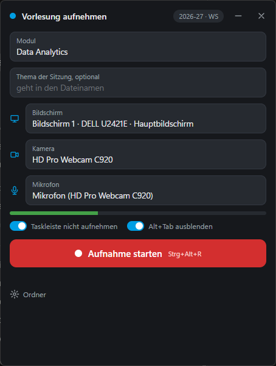
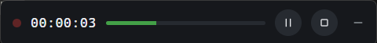

These are tools I built because I needed them in my own teaching and research. All of them are public on GitHub, and most are released under the MIT licence, so you are welcome to use and adapt them.

## stagekit

Slide decks as HTML: one file per deck, drawings as SVG, live demonstrators embedded right on the slide, and the whole design taken from a single theme file. Decks build up step by step instead of animating, open speaker notes in a second window, offer a laser pointer, and export to PDF.

stagekit started in the LiFi Project and now carries my lectures and talks. It comes with a skill that lets an AI agent build new decks following its rules, so the design stays consistent from one deck to the next. You can see it at work on the course websites of the [LiFi Project](https://docs.lifi-project.de/) and [Artificial Intelligence](https://ai.hands-on-computer-science.de/).

[stagekit on GitHub](https://github.com/winf-hsos/stagekit) · MIT licence

## LabelBench

LabelBench evaluates classifiers against a gold standard and shows every result in a self-contained HTML report that domain experts can browse row by row. Because the classifier is interchangeable, a hand-written rule set and a large language model are run, evaluated and compared in exactly the same way, which shows within minutes whether a change helped and on which items it did not.

[LabelBench on GitHub](https://github.com/winf-hsos/labelbench) · MIT licence · version 0.3

## Lecture Recorder

A small Windows app that records lectures locally with OBS Studio, built as a replacement for recording through Microsoft Teams. It captures screen, webcam and microphone in one go and afterwards files two synchronized videos, screen and camera, into a folder per term and module.

::: {layout="[[60,40]]"}
{fig-alt="Setup window of the Lecture Recorder with fields for module, screen, camera and microphone"}

::: {}
While recording, the window shrinks to a slim bar and is never captured itself. The taskbar stays out of the picture, a hotkey pauses and resumes, and stopping first asks whether to keep the recording, so an accidental click costs nothing.

{fig-alt="The slim recording bar of the Lecture Recorder"}
:::
:::

[Lecture Recorder on GitHub](https://github.com/winf-hsos/lecture-recorder) · MIT licence

## Markwise

::: {.callout-note appearance="minimal"}
In development.
:::

A desktop app for paper exams: it keeps a bank of multiple-choice and free-text questions, builds exams from it, reads the scanned answer sheets and turns them into grades. Free-text answers are marked by hand on paper, with the points ticked in a box strip that the scan reads as well. Markwise runs natively on Windows, needs neither Linux nor LaTeX, and is meant for examiners without any technical background.

[Markwise on GitHub](https://github.com/winf-hsos/markwise)
